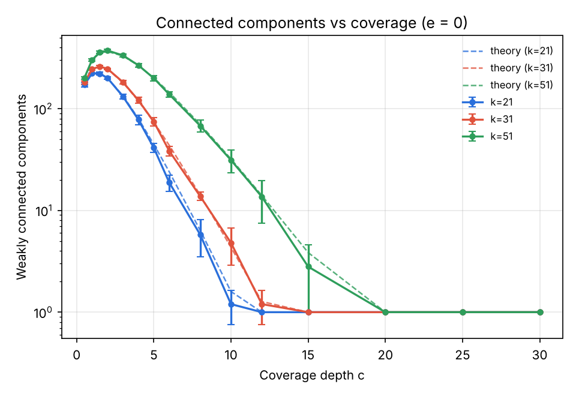
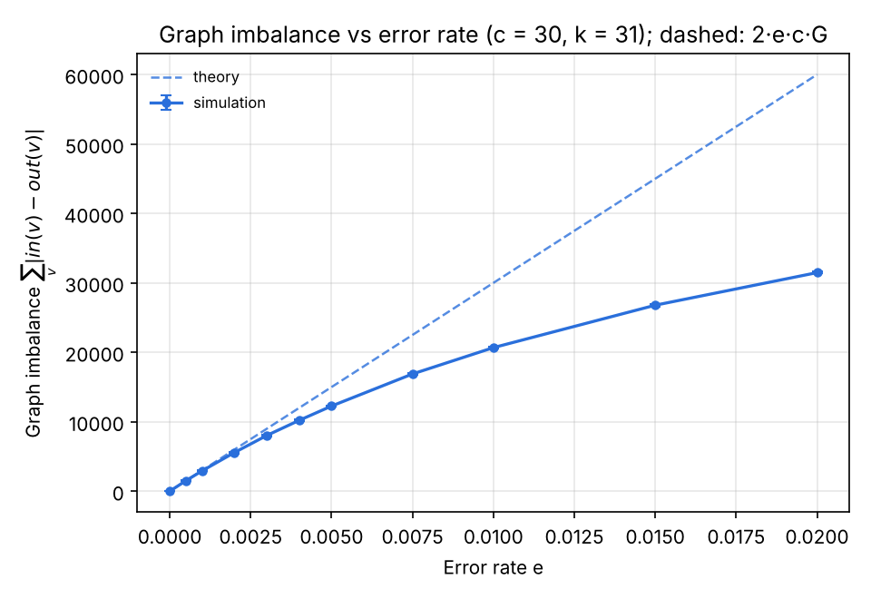
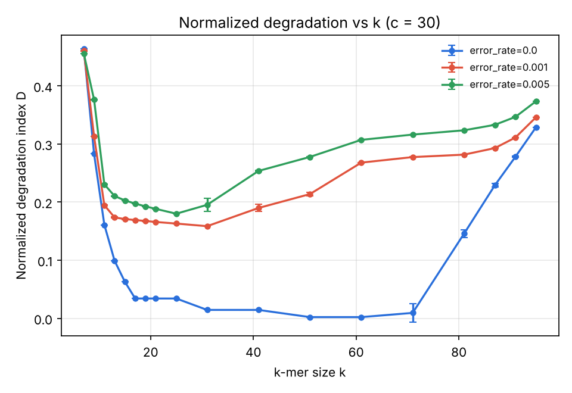
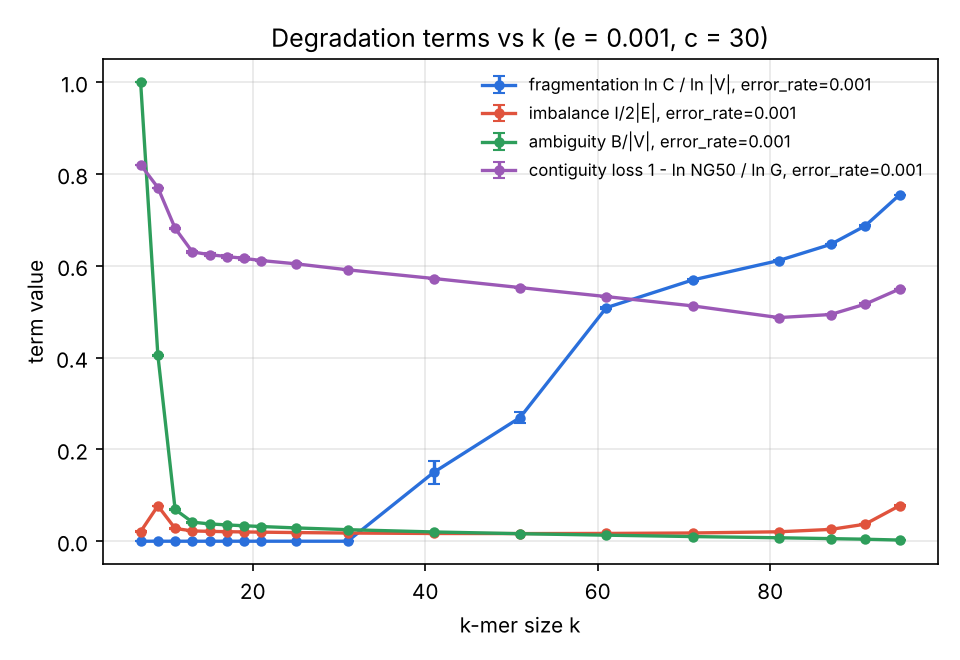

# Degradation of De Bruijn Graphs in Genome Assembly

A from-scratch Python pipeline for the project *"Analyzing the Degradation of De Bruijn
Graphs in Genome Assembly"*. It simulates reads from a reference genome, builds the
De Bruijn graph, runs the Eulerian traversal (Pevzner et al. 2001), extracts contigs, and
measures how the graph degrades as coverage `c`, error rate `e` and k-mer size `k` vary.

## Quick start

```bash
pip install -r requirements.txt
python -m pytest              # correctness checks from the proposal
python -m debruijn all        # the three pre-defense sweeps -> results/
```

Run one sweep at a time:

```bash
python -m debruijn coverage   # coverage sweep  (e = 0)            configs/coverage_sweep.json
python -m debruijn error      # error sweep     (fixed c, fixed k) configs/error_sweep.json
python -m debruijn kmer       # k-mer sweep     (small e, high c)  configs/kmer_sweep.json
```

Each sweep writes to `results/<name>/`: `raw.csv` (one row per run), `summary.csv`
(mean and std over replicates), a copy of the `config.json` used, and the PNG plots.

### Configuring experiments

Every sweep is a JSON file with a `base` configuration, one `x` parameter to vary, an
optional `series` parameter (one line per value), `replicates`, and a list of `plots`.
You can override any field from the command line without editing the file:

```bash
python -m debruijn coverage --set k=25 --set genome.length=100000 --replicates 10
python -m debruijn kmer --set coverage=15 --set series.values=[0,0.002]
python -m debruijn error --set x.values=[0,0.001,0.002] --jobs 4
python -m debruijn sweep my_custom_sweep.json   # any parameter as x / series
```

Single run (prints every metric):

```bash
python -m debruijn run --k 31 --coverage 20 --error-rate 0.001
python -m debruijn run --k 31 --coverage 30 --error-rate 0.005 --min-count 3   # k-mer cutoff
```

Configuration keys (defaults in `debruijn/pipeline.py`):

| key | meaning | default |
|---|---|---|
| `genome.length` | random genome length (bp) | 50000 |
| `genome.seed` | genome seed (fixed across replicates) | 0 |
| `genome.circular` | circular (bacterial) or linear genome | true |
| `genome.repeats` | planted exact repeats, e.g. `[{"length": 40, "copies": 3}]` | `[]` |
| `genome.fasta` | load a real reference instead (first record, optional `length` cap) | – |
| `read_length` | read length `L` | 100 |
| `coverage` | coverage depth `c` (number of reads `N = cG/L`) | 30 |
| `error_rate` | per-base substitution probability `e` | 0 |
| `k` | k-mer size (edges are k-mers, nodes are (k-1)-mers) | 31 |
| `min_count` | k-mer frequency cutoff, 1 = off (the proposal's extension) | 1 |
| `weights` | weights of the degradation index terms | equal |

## Pipeline

| step | module |
|---|---|
| reference genome (random i.i.d., planted exact repeats, or FASTA) | `debruijn/genome.py` |
| read sampling: uniform starts (Poisson / Lander-Waterman), i.i.d. substitutions | `debruijn/reads.py` |
| De Bruijn graph: (k-1)-mer nodes, distinct k-mer edges, k-mer multiplicities | `debruijn/graph.py` |
| Euler condition and Hierholzer's algorithm, run on each weakly connected component | `debruijn/euler.py` |
| contigs = maximal non-branching paths (unitigs), NG50 | `debruijn/contigs.py` |
| metrics and degradation index | `debruijn/metrics.py` |
| closed-form expectations (theory overlays) | `debruijn/theory.py` |
| sweeps, replicates, CSV, plots, CLI | `debruijn/sweep.py`, `plotting.py`, `__main__.py` |

## Metrics

All metrics are computed on the graph of **distinct** k-mers. That is the classic
Eulerian formulation, and it is what lets errors show up as imbalance.

* `components`: number of weakly connected components `C`.
* `imbalance`: `I = Σ_v |in(v) − out(v)|` (0 means every component has an Euler circuit).
* `dead_ends` (tip ends, `in+out = 1`) and `branching` nodes (`in>1` or `out>1`).
* `eulerian_frac`: fraction of components that satisfy the Euler condition.
  `reconstructed` is true when the graph is a single component and its Euler path or
  circuit spells exactly the reference (up to rotation for a circular genome).
* Ground-truth checks: `missing_kmer_frac` (coverage gaps), `spurious_kmer_frac`
  (error k-mers), `repeat_collapse_frac` (genome k-mers that occur more than once).
* Contigs: `n_contigs`, `max_contig`, `ng50`.

**Normalized degradation index.** Each term lies in [0, 1] and is exactly 0 in the ideal
case (circular genome, all k-mers sampled, no errors, k above the longest repeat):

```
frag       = ln C / ln |V|              weak fragmentation
imbalance  = I / (2|E|)                 departure from Eulerian balance
ambiguity  = B / |V|                    branching (collapsed repeats, bubbles, tips)
contiguity = 1 − ln NG50 / ln G         contig contiguity loss

D = w_f·frag + w_i·imbalance + w_a·ambiguity + w_c·contiguity      (Σw = 1, default 1/4 each)
```

The fragmentation and contiguity terms are log-scaled because `C` and NG50 range over
several orders of magnitude. With linear ratios (`1 − 1/C`, `1 − NG50/G`) the terms jump to
about 1 after only a few breaks, and the curves become flat.

## Correctness checks (`tests/test_correctness.py`)

These are the checks listed in the proposal. All 20 tests pass.

1. **Error-free, high coverage.** One component; imbalance 0 for a circular genome (2 for
   a linear one: the start and end nodes); the Euler circuit spells the genome exactly;
   `D = 0`.
2. **Controlled point mutations.** Every error placed in the middle of a read adds exactly
   `k` new k-mers, one bubble, 2 to the imbalance and 2 branching nodes, with no dead ends.
   Every error at a read end adds one tip (1 dead end) and 2 to the imbalance. Tested for
   0–50 mutations.
3. **Exact repeat of length R.** Duplicate k-mers exist if and only if `k ≤ R`; branching
   nodes exist if and only if `k ≤ R+1`; the Euler circuit recovers the genome if and only
   if `k > R`. (At `k = R+1` the repeat node has in = out = 2, so the graph is still
   balanced. With two copies on a circle, both Euler circuits spell the same cyclic genome.)
4. **Invariants and theory.** Degree conservation (`Σin = Σout = |E|`); the component count
   decreases with coverage and is within 25 % of Lander-Waterman; the imbalance is about 2
   per error; the unitigs cover every edge exactly once.

## Pre-defense results (`results/`)

Settings: 50 kb random circular genome, `L = 100`, mean ± std over replicates.
The full sweep takes about 1 minute on 4 cores.

### 1. Coverage sweep (`e = 0`, k ∈ {21, 31, 51}, 5 replicates)



For `c ≳ 2`, the component count decays exponentially (a straight line on the log
axis) and matches the Lander-Waterman expectation `C ≈ N·exp(−c(L−k+1)/L)` (dashed) almost
exactly, until it reaches 1. Larger `k` needs more coverage, because only `L−k+1` k-mers fit
in a read. **Note:** below `c ≈ 2` the count *increases* with coverage. When there are very
few reads, each new read adds an island rather than bridging a gap. The decay hypothesis
therefore only holds in the `c > 2` regime.

### 2. Error sweep (`c = 30`, `k = 31`, 5 replicates)



At low `e` the imbalance grows linearly and matches the first-order prediction
`I ≈ 2·e·c·G` (2 per error: each bubble or tip unbalances its two attachment nodes).
Measured imbalance per error: 1.96 at `e = 0.0005`, 1.84 at `e = 0.002`, 1.63 at
`e = 0.005` and 1.05 at `e = 0.02`. The curve becomes **sub-linear** because error
structures start to interact: errors less than `k` apart in a read share one structure,
identical errors in different reads share k-mers, and one error's re-join node can be
another error's branch node (in = out = 2, balanced again).

### 3. k-mer sweep (`c = 30`, e ∈ {0, 0.001, 0.005}, repeats of 15/25/40/60 bp, 3 replicates)




* **With errors:** a clear U-shape. Small `k` collapses repeats (ambiguity and contiguity
  loss are high). Large `k` breaks the graph apart, because the effective k-mer coverage
  `c(L−k+1)/L·(1−e)^k` drops and coverage gaps appear. The minimum is around `k ≈ 25–31`.
  A higher `e` raises the floor and moves the right arm to smaller `k`.
* **Without errors, at c = 30:** `D` reaches about 0 once `k` exceeds the longest repeat
  (60 bp). However, it does **not** stay flat up to `k = L`. Above `k ≈ 75`, fewer than
  about 26 k-mers per read remain, and gaps appear even at this "high" coverage. This
  slightly contradicts the proposal's prediction that error-free degradation is flat.

## Simplifications and known limitations

* Reads come from the forward strand only (no reverse complements), and only
  substitution errors are simulated (no indels).
* The Euler traversal uses distinct k-mers. Copy number is not inferred, so collapsed
  repeats make the Euler path shorter than the genome.
* The default genome is a 50 kb random sequence, chosen for speed. A real bacterial
  reference can be used via `genome.fasta`. Pure-Python cost is about 0.3–1 s per run at
  50 kb and 30× coverage, and scales linearly.
